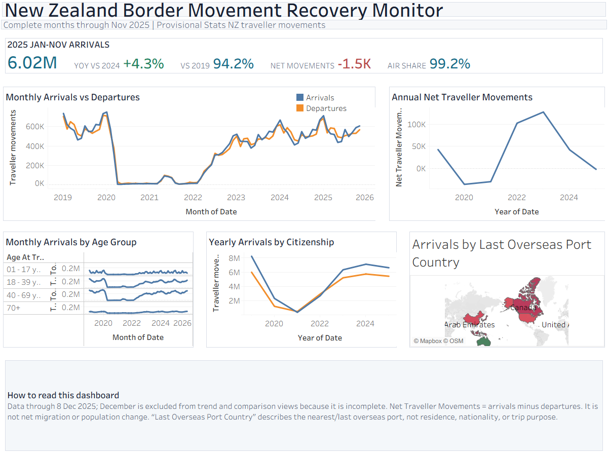
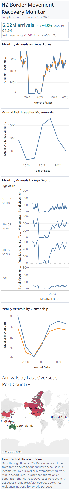

# New Zealand Border Movement Recovery Monitor

[](https://github.com/liyang6620/nz-border-movements-tableau/actions/workflows/ci.yml) [](LICENSE)

A Tableau BI project that tracks New Zealand traveller movements before, during, and after COVID-19 using provisional Stats NZ data.



[Open the interactive Tableau Public dashboard](https://public.tableau.com/app/profile/yang.li7346/viz/nz-border-movements/ImpactofCOVID-19onNewZealandBorderMovements20192025)

## Decision Context

The dashboard answers a deliberately narrow set of questions supported by the source data:

- How have monthly arrivals and departures changed since 2019?
- How close are 2025 arrival volumes to the comparable 2019 period?
- How do movement patterns vary by age group and citizenship?
- Which countries appear most often as the last overseas port before arrival?
- What share of arrivals travel by air?

It does **not** infer traveller purpose, residence, tourism demand, labour supply, or migration status.

## Headline Results

All comparisons use January-November so that periods are like-for-like. The extract is current through 8 December 2025, but December is excluded because it is incomplete.

| Metric | Result | Definition |
| --- | ---: | --- |
| 2025 arrivals | 6.02M | Arrival movements, Jan-Nov 2025 |
| Year-on-year change | +4.3% | 2025 Jan-Nov vs 2024 Jan-Nov arrivals |
| Recovery vs 2019 | 94.2% | 2025 Jan-Nov arrivals / 2019 Jan-Nov arrivals |
| Net traveller movements | -1.5K | Arrivals minus departures, Jan-Nov 2025 |
| Air share | 99.2% | Air arrivals / all arrivals, Jan-Nov 2025 |

The largest 2024 arrival age band is 40-69 (2.90M), not 18-39 (2.21M). This is a descriptive traveller-movement result and should not be interpreted as a labour-market conclusion.

## Dashboard Design

The 1200 x 900 desktop layout prioritises the monthly movement trend and a compact KPI strip. Supporting views cover annual net traveller movements, age, citizenship, and last overseas port country; air share is summarised once in the KPI strip instead of repeated in a low-information chart. A purpose-built phone layout stacks the same analytical sequence instead of shrinking the desktop canvas.



Key safeguards are visible in the dashboard:

- Incomplete months are excluded from analytical views.
- Data freshness is stated explicitly.
- `Net Traveller Movements` is not labelled or described as net migration.
- `Last Overseas Port Country` is not presented as origin, residence, or nationality.

## Data

| Item | Value |
| --- | --- |
| Source | Stats NZ international travel, provisional |
| Coverage | 1 Jan 2019 to 8 Dec 2025 |
| Latest complete month | Nov 2025 |
| Rows | 2,222,255 |
| Total traveller movements | 60,866,193 |
| Grain | Aggregated traveller movements by date and available dimensions |
| Packaged extract | `workbook/nz-border-movements.twbx` |
| Validation extract | `data/nz_border_movements_2019_2025.hyper` |

See [data dictionary](docs/DATA_DICTIONARY.md), [metric definitions](docs/METRIC_DEFINITIONS.md), and [validation evidence](docs/VALIDATION.md).

## Repository Structure

```text
.
|-- data/                 # Hyper extract used by automated data checks
|-- docs/                 # Definitions, assumptions, and validation evidence
|-- screenshots/          # Desktop and phone dashboard evidence
|-- scripts/              # Deterministic TWBX transformation tooling
|-- tests/                # Workbook and Hyper integrity tests
`-- workbook/             # Packaged Tableau workbook
```

## Reproduce and Validate

Requirements:

- Python 3.12+
- Tableau Desktop or Tableau Public 2025.3+ to edit the workbook

```bash
python -m pip install -r requirements-dev.txt
python -m unittest discover -s tests -v
```

Open `workbook/nz-border-movements.twbx` to inspect or publish the dashboard. The packaged workbook contains its own Hyper extract and does not require the original spreadsheet path.

To deterministically reapply reviewed workbook definitions and layout changes:

```bash
python scripts/transform_workbook.py
```

## Limitations

- December 2025 is partial and excluded from trend and comparison views.
- The data counts movement events, not unique people.
- Arrivals minus departures is not net migration and cannot measure population change.
- Citizenship is not residence, visa type, trip purpose, or visitor status.
- Last overseas port country is the nearest/last overseas port in the journey, not necessarily the traveller's origin.
- Provisional data may be revised by Stats NZ.
- The workbook is a portfolio-grade BI demonstration, not an operational forecasting or policy system.

## Governance

Contributions are described in [CONTRIBUTING.md](CONTRIBUTING.md), security reporting in [SECURITY.md](SECURITY.md), and release history in [CHANGELOG.md](CHANGELOG.md). Code and workbook configuration are available under the [MIT License](LICENSE); the underlying data remains subject to the source provider's terms.

